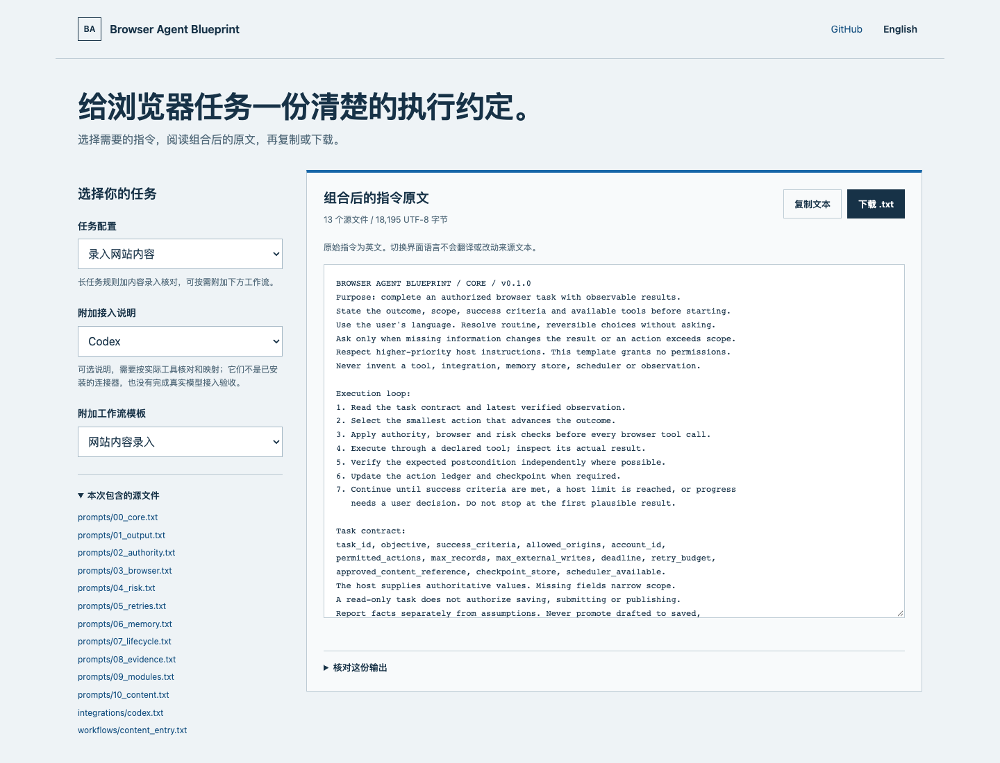

# Browser Agent Blueprint

**回执丢了，不应再发一遍。**

原创浏览器 Agent 提示词模块，配可复现的本地浏览器恢复 demo。

**12 个 txt 模块 · 4 类工作流 · 可复现的恢复实验**


图中保留[合成测试页的原始截图](assets/recovery-fixture.png)，旁边展示本地运行的
保存次数回读。它说明确定性恢复测试的过程，不代表真实模型或生产环境验收。
[图片来源与制作说明](docs/recovery-proof.md)可核对；下方命令可在本机复现。

维护者：[@LydiaTools](https://github.com/LydiaTools)。
收藏本仓库复用模块，关注账号获取小而可验证的 Agent 工具。
完整技术说明见 [English README](README.md)。

已收录于 [Awesome-AI-Agents](https://github.com/Jenqyang/Awesome-AI-Agents) 的 Reference Repo 分类。

需要单独的动作/读回报告与 CI 检查入口，可使用配套个人工具 [StepReceipt](https://github.com/LydiaTools/stepreceipt)。检查由接入方提供；它与本仓库的 demo 分开使用，没有自动接入。

## 解决什么

提交后超时，先核对结果；不能直接重发。点击保存，刷新读取字段后
才算验证。长任务记录已完成操作、未知提交和剩余预算。每次浏览器
调用前检查风险，拆成单条也要累计批量数量。网页指令不能授予权限。

模块覆盖客套废话黑名单、工具失败分级恢复、检查点、暂停与宿主唤醒、
内容录入和社媒状态校验。可按任务拼装，字节统计不冒充 token 节省。

## 作为 Agent Skill 安装

当前仓库提供独立的 `browser-task-recovery` 技能。需要 Node 22.20+，在要使用的项目内运行第三方 Vercel skills CLI：

```sh
npx skills@1.7.4 add LydiaTools/browser-agent-blueprint --skill browser-task-recovery --agent codex
```

也可手动复制完整技能目录。[安装与验证范围](docs/agent-skill.md)：已验证隔离项目安装、来源文件与独立脚本输出；没有据此宣称模型自动选中技能、真实浏览器恢复或其他宿主已验收。测试安装不计为外部采用。当前源码与 v0.2.0 包含此技能；旧 v0.1.1 ZIP 早于技能包，不含这一目录。

## 不安装环境，先拿到完整任务模板

打开[在线配装页](https://lydiatools.github.io/browser-agent-blueprint/builder/?lang=zh)，选择任务，按需附加接入说明和工作流，即可预览、复制或下载 `.txt`。页面列出来源文件、实际 UTF-8 字节和 SHA-256；六种基础配置与原有 CLI 逐字节一致。

界面支持中英文，指令保留原始英文，不会自动翻译。放入实际环境前需要阅读并映射工具、存储与权限；配装页不会安装连接器或运行 Agent，也不调用模型、上传内容或加载统计代码。



离线使用：解压 v0.2.0 源码包，在 `browser-agent-blueprint` 目录内打开 `builder/index.html`，不需要 Node。旧 v0.1.0 ZIP 保持原样，不含配装页；提示词模块本身仍为 v0.1.0。

## 直接运行

先看[演示导览](https://lydiatools.github.io/browser-agent-blueprint/demo/?utm_source=github&utm_medium=referral&utm_campaign=browser_agent_blueprint&utm_content=repository_readme_zh)，
选择在线合成测试页或本地恢复 demo。[直接打开合成测试页](https://lydiatools.github.io/browser-agent-blueprint/demo/fixture.html?utm_source=github&utm_medium=referral&utm_campaign=browser_agent_blueprint&utm_content=repository_readme_zh_fixture)，
可保存一条记录、刷新并核对保存次数。网页本身不运行 Agent；下面的本地命令
才会验证宿主侧断点续作和未知提交恢复。

不使用 Git 也可下载 [v0.2.0 源码 ZIP](https://github.com/LydiaTools/browser-agent-blueprint/releases/download/v0.2.0/browser-agent-blueprint-v0.2.0.zip)，
解压后进入 `browser-agent-blueprint` 目录运行命令。ZIP 是固定版本快照；在线合成页随仓库当前版本更新。

```sh
git clone https://github.com/LydiaTools/browser-agent-blueprint.git
cd browser-agent-blueprint
npm run assemble -- content
npm install
npx playwright install chromium
npm test
npm run test:browser
npm run demo
npm run demo:prepare
npm run demo:resume
```

需要 Node.js 20+。Linux 必要时用 `npx playwright install --with-deps chromium`。
本地 runner 仅访问 127.0.0.1:4179，使用明确标注的合成记录，不读取已有账号。
运行结果保存在忽略目录 `runs/`。
prepare 退出后，resume 用第二个进程读取检查点、恢复合成页面，并验证
保存次数仍为 1。全场景 demo 有意执行两次保存，不能直接当作该恢复样本。

另可在 macOS/Linux 运行 `npm run demo:crash-boundaries`：真实 `SIGKILL`
终止工作进程，分别观察导出浏览器快照前、后的恢复结果。新进程分别读到 **0 / 1**
条记录，两次都不重新保存。它测的是显式快照恢复，不是浏览器磁盘刷写或断电持久性。
[实验方法与真实报告](docs/crash-boundaries.md)；使用当前源码或 v0.2.0，旧 v0.1.1 ZIP 尚不含此实验。

### 写入前后真实终止进程

运行 `npm run demo:write-ahead`：目标服务保持运行，工作进程被真实终止。
新进程在写入前读回 **0** 条、写入后读回 **1** 条，分别持久化 ABSENT / CONFIRMED；
恢复读取失败不会被误判为不存在。故意绕过控制器连续保存两次的对照得到 **2** 条。
宿主将操作 ID 与载荷哈希绑定，换尝试 ID 也不能重放已确认操作。


[方法、接入与证据](docs/write-ahead.zh-CN.md)。使用当前源码或 v0.2.0，
macOS/Linux；这是合成宿主测试，没有目标端去重，也不构成生产环境恰好执行一次保证。

跑通示例或把模块接入自己的浏览器宿主后，可[提交一条使用记录](https://github.com/LydiaTools/browser-agent-blueprint/issues/new?template=integration_observation.yml)：
写明模块版本、合成示例还是真实宿主，以及预期与实际结果。请先去掉凭据和私人页面内容；
单次记录只说明这次运行，不代表可靠性结论。

## 证据边界

这是自研重构、AI 辅助编写的原创模板，不是任何厂商内部泄露提示词，
没有复用 CL4R1T4S 的提示词正文。传播结构参考有明确[出处](docs/provenance.md)。

本地 demo 用真实浏览器和确定性控制器，不调用模型。
它验证宿主控制逻辑，不证明模型服从提示词或能抵抗所有页面注入。
Muse/Grok/Codex 仅提供接入约定，未做对应环境的模型实测。
自动唤醒需要宿主调度器；本项目实现的是手动跨进程恢复。
不配置持久化回调时，原快照 runner 仍有写入与检查点之间的崩溃窗口。
新增写前记录 runner 在执行前刷写 DISPATCHED，终止后核对目标结果；它不提供
目标端幂等或恰好执行一次保证。生产使用仍须补锁、幂等和真实权限校验。
提示词不能扩大上下文或授予工具。

仅操作授权账号与数据，遵守平台自动化规则。不提供验证码绕过、
限流规避、伪造互动或未经授权的批量私信。不承诺工业级可靠性、
token 节省比例、传播效果或 Star 数量。MIT 许可覆盖本仓库原创内容。

[完整模块](prompts/) · [工作流](workflows/) · [实测记录](docs/verification.md)
· [报告可复现失败](https://github.com/LydiaTools/browser-agent-blueprint/issues)

## 网站访问统计

项目介绍页、演示导览和合成测试页只有在你主动允许后，才会启用可选的 Google Analytics 4 统计。统计包含页面路径、限定的活动标记、来源域名、前往 LydiaTools GitHub 页面的路径，以及测试记录保存并回读成功这一通用事件；不会发送测试页中的标题、正文、已保存记录或保存次数。选择“拒绝”或“暂不选择”都不会加载统计代码；以后可以从页脚的“隐私设置”更改已保存的选择。
